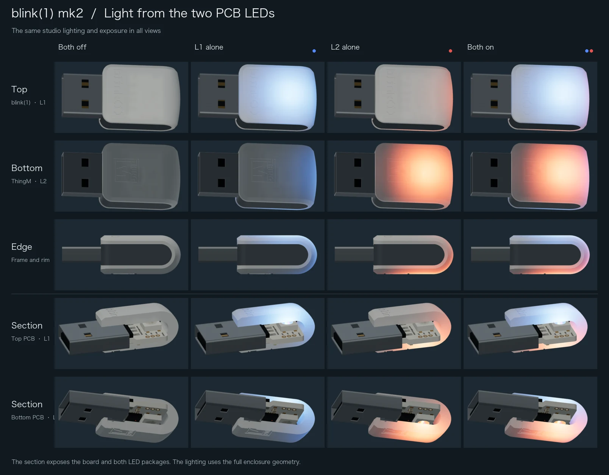
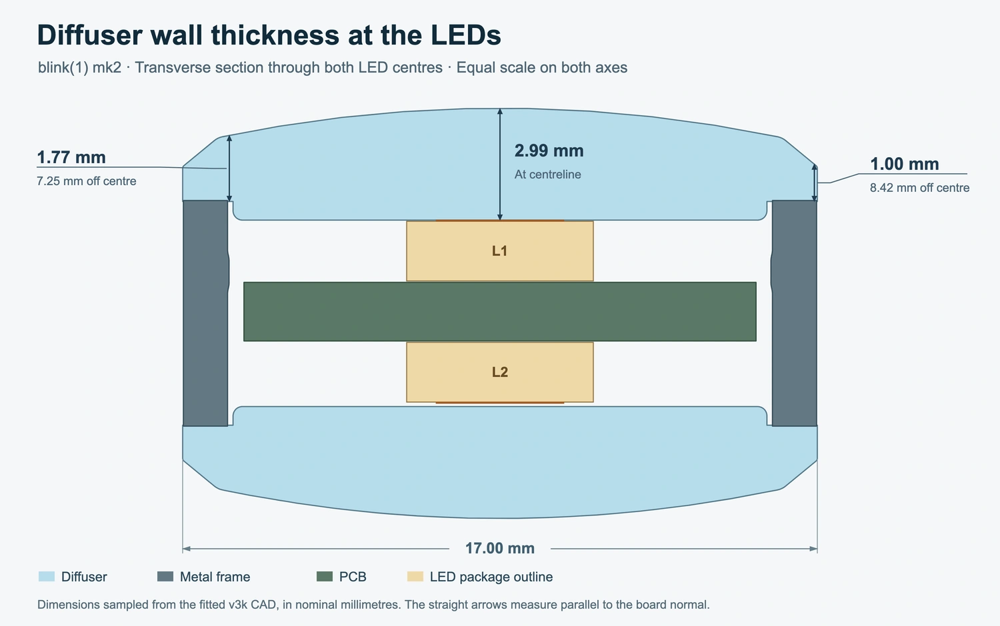

# blink(1) Models

The viewer opens with the blink(1) mk2 assembled and both PCB LEDs on. Use the checkbox and color picker for each LED to see its contribution to the diffuser. **Cutaway** opens a lengthwise section through the frame and diffuser, exposing the board and LED windows while showing the light field calculated for the closed assembly. **PCB only** shows the exposed board and **Empty shell** shows the unlit enclosure. The controls remember your choices as you switch views. The interactive viewer requires WebGL 2. [Open the model viewer](https://b1ug.github.io/blink1-models/)

This repository maintains the reusable geometry, assembly code, provenance and per-file checksums used by nb1 Debugger, nb1 WebHID and nb1 Guide. Each consumer can import a pinned version and ship it offline.

## Use the mk2 model

Download a [model release](https://github.com/b1ug/blink1-models/releases), or add its full Git commit tarball to your frontend dependencies. The root package contains the assets and assembly modules and has no runtime dependencies. Supply Three.js and STLLoader in your application. The model viewer uses Three.js 0.187.0.

The manifest lists every file in the model. When importing, verify the digest of the manifest from the pinned revision, then each file's byte length and SHA-256. Preserve relative paths, source notices and licenses. The release ZIP includes the same paths relative to its root. Run `python3 scripts/check.py` to verify a checkout. [Model manifest](models/mk2/manifest.json)

```js
import { createBlink1Model } from './models/mk2/light-model.js';

const root = new URL('./models/mk2/model-assets/', import.meta.url);
const [diffuserGeometry, frameGeometry] = await Promise.all(
  ['diffuser', 'frame'].map(part => loader.loadAsync(
    new URL('blink1mk2_enclosure_' + part + '_v3k.stl', root).href
  ))
);
const model = createBlink1Model(THREE, { diffuserGeometry, frameGeometry, variant: 'assembled' });
diffuserGeometry.dispose();
frameGeometry.dispose();
scene.add(model.group);
model.setColors('#dd4444', '#4488dd', 'preview');
```

`variant` accepts `assembled`, `internals` (PCB and USB plug), or `shell` (the API default). Models start unlit. Pass `setColors(led1, led2, 'preview')` two `#rrggbb` values in device RGB. Each byte supplies the linear PWM duty fraction for that channel, so `#800000` drives red at about half power. Pass `null` for either LED to turn it off. Call `model.dispose()` when finished.

A Node build can also import `stageModel` from `@b1ug/blink1-models/stage` and call `stageModel(destination, manifestSha256)`. Use a consumer-owned staging directory and the expected digest from your dependency lock. The helper verifies the manifest and all listed files before copying them.

## How the LEDs light the enclosure

ThingM’s v2c6 board places two WS2812B packages back to back at the same board coordinates, (10.414, 7.620) mm. L1 faces the blink(1) wordmark and L2 faces ThingM. Each 5 × 5 mm package contains red, green and blue emitters and a control IC. In the exposed-board view, the dies sit in a reflective well under a clear resin window. The window size follows the footprint. The internal die positions and well geometry are illustrative. [ThingM PCB layout](https://github.com/todbot/blink1/blob/101abe3599c661c4dd4d1204b4d50fb592293143/hardware/schematic/blink1mk2_v2c6.brd) · [ThingM board photos and LED numbering](https://thingm.com/blog/2017/12/using-the-blink1-mk2-led-strip-adapter) · [Worldsemi WS2812B datasheet, pp. 1–2](https://cdn-shop.adafruit.com/datasheets/WS2812B.pdf)

The assembled model traces rays from each circular window into the outward hemisphere using a cosine-weighted (Lambertian) distribution. Rays cross air gaps until they reach the diffuser or hit the opaque metal frame or PCB. A steady-state diffusion solver spreads and absorbs light within the plastic volume of the fitted CAD. Where light leaves a plastic wall into air, the model traces outward rays to see how much reaches another wall. The angle of incidence determines how much of that flux enters the receiving plastic, using Fresnel transmission and an assumed refractive index of 1.44. The curved end picks up light from both LEDs along these paths. The metal frame and PCB block paths through them. The renderer stores a separate light field for each LED, multiplies each field by that LED’s RGB drive, and adds them before tone mapping. On the exposed PCB, the dies and resin show the selected drive and each window casts light outward.

For light falling on nearby objects, such as a tabletop, the assembled model integrates the outgoing brightness over the area of each diffuser face and represents each face with one outward light. This step uses the result of the internal diffusion solve. The absorption, scattering, boundary losses and absolute output in lumens have yet to be measured for this model. The two-color photos show the extent of the transition at the rounded end and the spill below the metal rail. [ThingM illuminated mk2 photo](https://github.com/todbot/blink1/blob/101abe3599c661c4dd4d1204b4d50fb592293143/docs/imgs/blink1mk2-twocolor-long.jpg) · [GIGAZINE’s close-up of the illuminated edge](https://i.gzn.jp/img/2014/08/04/blink1-mk2/P2220583.jpg)



## Diffuser wall thickness

At the LED station, 14.52 mm behind the USB end of the cover, the v3k design has roughly 3.00 mm of plastic above and below the LEDs. Each wall tapers to 1.77 mm near the rail and 1.00 mm at its outer lip. Select **Cutaway** and switch between **Center**, **Near rail** and **Outer lip** to see the sections and their top and bottom measurements. The measurements use the assembled model’s nominal millimetre scale. The teardown photograph shows the removable diffuser and its seats, while the internal dimensions come from the CAD. [ThingM diffuser STL](https://github.com/todbot/blink1/blob/101abe3599c661c4dd4d1204b4d50fb592293143/hardware/enclosure/blink1mk2_enclosure_diffuser_v3k.stl) · [GIGAZINE’s mk2 teardown photo](https://i.gzn.jp/img/2014/08/04/blink1-mk2/P2220588.jpg)



## Model and licensing

The two STL files contain ThingM’s original v3k enclosure geometry. In the assembled model, the diffuser follows the two straight metal rails behind the USB plug. Their upper and lower edges are parallel up to the rounded tips, as seen in the mk2 side photo. The renderer adjusts the diffuser along its length while retaining its curved cross-section, engraved faces and rounded tail. The STL dimensions are in undeclared model units. [ThingM enclosure CAD](https://github.com/todbot/blink1/tree/101abe3599c661c4dd4d1204b4d50fb592293143/hardware/enclosure) · [ThingM side photo](https://github.com/todbot/blink1/blob/101abe3599c661c4dd4d1204b4d50fb592293143/docs/imgs/blink1mk2-twocolor-long.jpg)

The USB plug has four staggered contacts and retention holes on both broad faces. Its front edge and solder tails are positioned relative to the X1 footprint. The PCB outline, nominal board thickness and pad locations follow the mk2 v2c6 EAGLE board. Some component heights are estimates. [ThingM PCB layout](https://github.com/todbot/blink1/blob/101abe3599c661c4dd4d1204b4d50fb592293143/hardware/schematic/blink1mk2_v2c6.brd) · [USB-IF Type-A interface drawing, page 4](https://www.usb.org/sites/default/files/CCWG_A_Plug_Form_Factor_Guideline_Revision_1.0_.pdf#page=4)

The renderings show the rail profile and shoulder finish before and after the correction, and both sides of the PCB with their unlit and powered WS2812B windows. The enclosure render uses the enclosure's CC BY-SA 4.0 license, and the board render uses the PCB's CC BY-SA 3.0 license. [Enclosure comparison](docs/images/mk2-enclosure-comparison.webp) · [PCB top and bottom](docs/images/mk2-pcb-assembly.webp)

The enclosure geometry and derivatives carry [CC BY-SA 4.0](models/mk2/model-assets/LICENSE.txt). The upstream blink(1) README declares [CC BY-SA 3.0](https://github.com/todbot/blink1/blob/main/README.md) for the PCB source; the derived layout is documented in [PCB-LICENSE.txt](models/mk2/model-assets/PCB-LICENSE.txt). The [source record](models/mk2/model-assets/source.json) documents each source and modification. Assembly code is supplied under the [MIT license](LICENSE). blink(1) is a ThingM trademark.

## Build the catalog

```sh
npm ci --prefix site --ignore-scripts
python3 scripts/check.py --site --bundle
python3 -m http.server --directory dist/site 8000
```

Open `http://localhost:8000/`. The generated viewer and model files are self-contained. GitHub Actions checks file integrity and builds both the catalog and versioned model archive.
